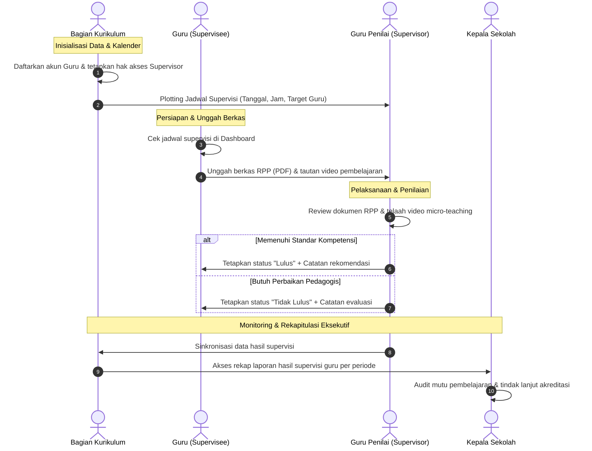
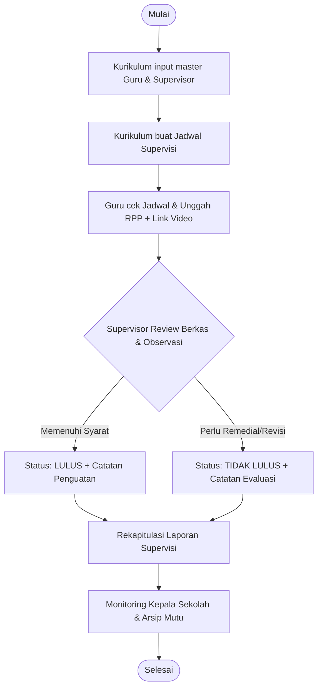
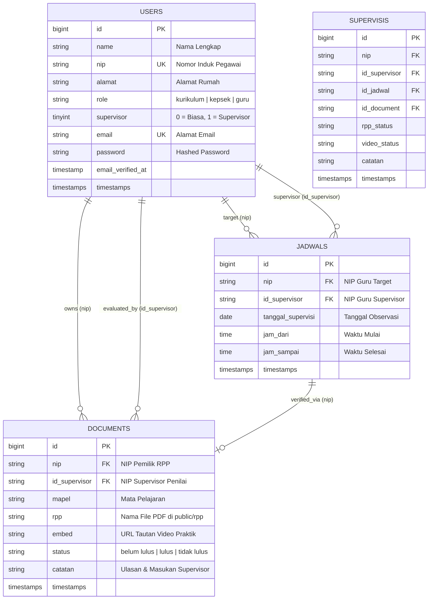

# School Academic Supervision Information System (Supervisi App)

<p align="center">
  
</p>

<p align="center">
  <a href="https://laravel.com"></a>
  <a href="https://php.net"></a>
  <a href="https://getbootstrap.com"></a>
  <a href="https://www.mysql.com"></a>
  <a href="LICENSE"></a>
</p>

---

## 📌 Problem Statement & Overview

In educational institutions, **academic supervision** is a foundational process for quality assurance, teacher professional development, and curriculum compliance. Traditional school supervision workflows often encounter severe operational challenges:

* **Fragmented Document Management**: Lesson plans (*Rencana Pelaksanaan Pembelajaran* / RPP) and instructional syllabi are physically submitted on paper or dispersed across unmanaged email threads and chat groups.
* **Manual and Unsynchronized Scheduling**: Matching available peer supervisors with target teachers leads to timetable conflicts, missed observation windows, and lack of accountability.
* **Lack of Centralized Learning Artifacts**: Video recordings of classroom teaching practices and pedagogical evidence are rarely archived or paired directly with evaluation notes.
* **Delayed Decision-Making**: Principals and curriculum coordinators lack real-time visibility into school-wide supervision progress, impeding data-driven teacher evaluations and semester-end accreditations.

### 💡 The Solution

**Supervisi App** is a centralized web-based Academic Supervision Information System developed with **Laravel 8** and **Bootstrap 5 (SB Admin 2)**. It provides a secure, role-governed environment connecting **Curriculum Directors**, **Teachers (Supervisees)**, **Peer Supervisors**, and **School Principals** to automate and track the entire supervision lifecycle from scheduling to evaluation and reporting.

---

## 🔄 Supervision Workflow Architecture

The academic supervision process follows a sequential, multi-stakeholder operational loop:



### Flowchart Proses Bisnis



---

## 👥 Role-Based Access Control (RBAC) Matrix

The system implements a role hierarchy combined with a dynamic supervisory privilege flag (`supervisor = 1`):

| Fitur / Modul | Guru (`guru`) | Supervisor (`supervisor = 1`) | Kurikulum (`kurikulum`) | Kepala Sekolah (`kepsek`) |
| :--- | :---: | :---: | :---: | :---: |
| **Login & Dashboard Profil** | ✅ | ✅ | ✅ | ✅ |
| **Lihat Jadwal Supervisi Mandiri** | ✅ | ✅ | ❌ | ❌ |
| **Unggah RPP (PDF) & Tautan Video** | ✅ | ❌ | ❌ | ❌ |
| **Pantau Status Kelulusan & Catatan** | ✅ | ❌ | ❌ | ❌ |
| **Daftar Tugas Supervisi & Target Guru** | ❌ | ✅ | ❌ | ❌ |
| **Review RPP & Streaming Video Guru** | ❌ | ✅ | ✅ | ✅ |
| **Input Nilai & Rekomendasi (Lulus/Tidak)** | ❌ | ✅ | ❌ | ❌ |
| **Manajemen Master Guru (Tambah Akun)** | ❌ | ❌ | ✅ | ❌ |
| **Promosi / Cabut Hak Supervisor** | ❌ | ❌ | ✅ | ❌ |
| **Atur & Hapus Kalender Jadwal Supervisi** | ❌ | ❌ | ✅ | ❌ |
| **Rekapitulasi Laporan Hasil Supervisi** | ❌ | ❌ | ✅ | ✅ |
| **Eksekutif Dashboard Monitoring** | ❌ | ❌ | ❌ | ✅ |

> [!NOTE]
> Seorang Guru yang ditunjuk oleh Kurikulum sebagai Supervisor (`supervisor = 1`) memperoleh akses ganda: portal guru untuk kewajiban mengajarnya sendiri dan portal supervisor untuk mengevaluasi guru sejawat.

---

## 🗄️ Skema Database Relasional (ERD)

Sistem menggunakan identifikasi unik berbasis **NIP** (*Nomor Induk Pegawai*) untuk menghubungkan entitas pengguna dengan agenda jadwal dan dokumen supervisi.



---

## 🔑 Kredensial Pengujian (Seeder Default)

Setelah menjalankan seeder bawaan (`php artisan db:seed` atau `UsersSeeder`), akun default berikut tersedia untuk pengujian:

| Role | Nama Pengguna | NIP (Username / Password Default) | Email | Hak Supervisor |
| :--- | :--- | :--- | :--- | :---: |
| **Kurikulum** | Kurikulum Supervisor | `1101` | `kurikulumsupervisor@abc.com` | `1` (Aktif) |
| **Kepala Sekolah** | Kepsek | `1102` | `kepsek@abc.com` | `1` (Aktif) |
| **Guru Baru** | *(Didaftarkan Kurikulum)* | Ditetapkan saat input | Ditetapkan saat input | `0` (Dapat dipromosikan) |

> [!TIP]
> Pada sistem ini, akun Guru baru yang didaftarkan melalui menu **Kurikulum > Tambah Guru** secara otomatis menggunakan nilai **NIP** sebagai password awal default (`Hash::make($request->nip)`).

---

## 🚀 Panduan Instalasi & Setup Lokal

Ikuti langkah-langkah di bawah ini untuk menjalankan aplikasi pada lingkungan pengembangan lokal:

### Prasyarat
* PHP `>= 8.0` (disarankan PHP 8.0 - 8.2)
* Composer `>= 2.0`
* Node.js `>= 14.x` & NPM
* Database Server (MySQL / MariaDB)

### 1. Clone Repository
```bash
git clone https://github.com/fauzanlm/supervisi-app-in-laravel.git
cd supervisi-app-in-laravel
```

### 2. Pasang Dependensi Backend & Frontend
```bash
# Dependensi PHP
composer install

# Dependensi JavaScript & Kompilasi Aset
npm install
npm run dev
```

### 3. Konfigurasi Environment (`.env`)
Salin file template `.env.example` ke `.env`:
```bash
cp .env.example .env
php artisan key:generate
```

Sesuaikan parameter koneksi database pada file `.env`:
```dotenv
DB_CONNECTION=mysql
DB_HOST=127.0.0.1
DB_PORT=3306
DB_DATABASE=supervisi_app
DB_USERNAME=root
DB_PASSWORD=
```

### 4. Eksekusi Migrasi & Seeding Database
Jalankan migrasi skema tabel beserta data awal:
```bash
# Pastikan database telah dibuat di MySQL
php artisan migrate --seed
```

### 5. Pastikan Izin Direktori Upload Dokumen
Aplikasi menyimpan file RPP berformat PDF pada direktori `public/rpp/`. Pastikan direktori memiliki izin tulis:
```bash
mkdir -p public/rpp storage/framework/views storage/logs bootstrap/cache
chmod -R 775 storage bootstrap/cache public/rpp
```

### 6. Jalankan Server Pengembangan
```bash
php artisan serve
```
Aplikasi dapat diakses melalui browser pada: **`http://127.0.0.1:8000`** (otomatis dialihkan ke halaman `/login`).

---

## 📁 Struktur Direktori Utama

```text
supervisi-app-in-laravel/
├── app/
│   ├── Http/
│   │   ├── Controllers/
│   │   │   ├── GuruController.php         # Handler unggah RPP & jadwal guru
│   │   │   ├── SupervisorController.php   # Penilaian & evaluasi berkas supervisi
│   │   │   ├── KurikulumController.php    # Manajemen guru, supervisor & jadwal
│   │   │   ├── KepsekController.php       # Monitoring laporan eksekutif
│   │   │   └── HomeController.php         # Redirection dashboard berbasis role
│   │   └── Middleware/
│   │       ├── Kurikulum.php              # Guard hak akses role kurikulum
│   │       ├── Supervisor.php             # Guard hak akses flag supervisor (1)
│   │       ├── Kepsek.php                 # Guard hak akses role kepala sekolah
│   │       └── PreventBackHistory.php     # Cache-control penghalang back-history browser
│   └── Models/
│       ├── User.php                       # Entitas pengguna & autentikasi
│       ├── Jadwal.php                     # Model relasi jadwal supervisi
│       ├── Documents.php                  # Model berkas RPP & video pembelajaran
│       └── Supervisi.php                  # Model rincian hasil observasi
├── database/
│   ├── migrations/                        # Definisi skema tabel database
│   └── seeders/                           # Seeder akun default (UsersSeeder)
├── public/
│   └── rpp/                               # Penyimpanan berkas PDF RPP guru
├── resources/
│   └── views/
│       ├── guru/                          # Tampilan dashboard & form upload guru
│       ├── supervisor/                    # Tampilan jadwal & form penilaian supervisor
│       ├── kurikulum/                     # Tampilan manajemen guru, jadwal & laporan
│       ├── kepsek/                        # Tampilan dashboard & laporan kepala sekolah
│       └── layouts/                       # Master template (SB Admin 2)
└── routes/
    └── web.php                            # Routing web & proteksi middleware
```

---

## 🛡️ Keamanan & Integritas Data

* **CSRF Protection**: Seluruh request state-changing (`POST`, `PATCH`, `DELETE`) dilindungi token CSRF Laravel.
* **Prevent Back History**: Middleware `PreventBackHistory` memastikan browser tidak memuat ulang halaman sensitif dari cache setelah pengguna logout.
* **MIME-Type & Size Validation**: Unggahan RPP dibatasi khusus dokumen berkas PDF dengan batas kapasitas maksimal 2048 KB (2 MB).
* **Hash Password**: Sandi akun dienkripsi menggunakan algoritma `Bcrypt` bawaan Laravel.

---

## 📄 Lisensi

Proyek ini didistribusikan di bawah lisensi **[MIT License](LICENSE)**.
